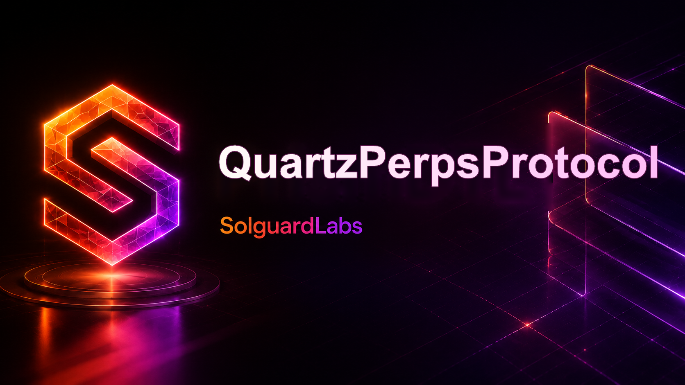

# Quartz Perps Protocol



QuartzPerpsProtocol es una implementación on-chain de mercados perpetuos con
margen aislado, posiciones marcadas por oráculo, índices de funding, checks de
margen de mantenimiento y settlement de liquidaciones.

El sistema usa un único activo de collateral para mercados configurables. Cada
mercado define feed de precio, parámetros de leverage, requisitos de
mantenimiento, límites de open interest, configuración de funding y fee de
liquidación. Los traders pueden abrir, aumentar, reducir y cerrar posiciones
direccionales mientras el protocolo contabiliza PnL no realizado y funding
acumulado.

## Componentes

- `QuartzPerpsProtocol`: punto de entrada para margen, posiciones, settlement de
  funding y liquidaciones.
- `PositionBook`: almacenamiento canónico de posiciones aisladas y exposición de
  mercado.
- `FundingEngine`: índices acumulados de funding y actualizaciones de keepers.
- `RiskEngine`: validación de margen, health factor y umbrales de liquidación.
- `OracleRouter`: feeds de precio acotados con checks de frescura.
- `CollateralVault`: custodia del collateral de settlement.
- `InsuranceFund`: accounting para fees, reservas y déficits.
- `QuartzLens`: vistas de cuenta y mercado para frontends y keepers.

## Flujo principal

1. Gobierno configura mercado, límites de riesgo, oráculo y funding.
2. El trader deposita margen y abre una posición long o short.
3. El protocolo actualiza exposición, skew y precio de entrada.
4. Los keepers actualizan índices acumulados de funding.
5. El trader puede aumentar, reducir, cerrar o retirar margen si mantiene salud
   suficiente.
6. Los liquidadores cierran posiciones por debajo de maintenance margin.
7. El insurance fund contabiliza fees, créditos y déficits.

## Seguridad y controles

- Roles para gobierno, precio, funding, pausa y operaciones internas.
- Checks de precio fresco y dentro de bounds.
- Validación de initial margin y maintenance margin.
- Límites de open interest y skew por mercado.
- Settlement de funding antes de cambios relevantes de posición.
- Accounting separado de collateral, insurance fund y position book.

Consulta [SECURITY.md](./SECURITY.md) para el alcance de revisión y las
invariantes esperadas.

## Requisitos

- Foundry 1.7.1 o superior.
- PowerShell en Windows para scripts `.ps1`.
- Bash para scripts `.sh` en CI Unix-like.

## Uso

Instalar dependencias si es necesario:

```bash
forge install foundry-rs/forge-std --no-commit
```

Build:

```bash
forge build
```

Tests:

```bash
forge test
```

CI local:

```bash
./scripts/ci.sh
```

Windows:

```powershell
.\scripts\ci.ps1
```

## Estructura

```text
src/
  access/       roles y controles de pausa
  assets/       custodia de collateral
  core/         funding, posiciones e insurance accounting
  errors/       errores personalizados
  events/       eventos del protocolo
  interfaces/   interfaces externas
  lens/         vistas read-only
  libraries/    fixed point y position math
  oracle/       router de feeds de precio
  risk/         checks de margen y liquidación
  types/        structs y constantes compartidas
test/
  helpers/      fixture de despliegue
  mocks/        token ERC20 de pruebas
  *.t.sol       pruebas Forge de integración
```
