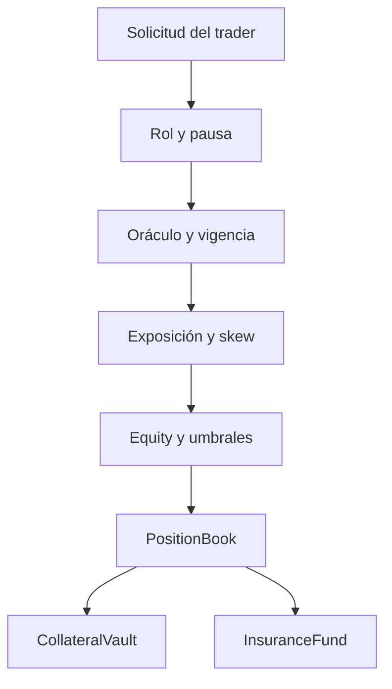

# Política de seguridad

Quartz Perps Protocol protege posiciones de margen aislado, collateral de
settlement, funding acumulado, límites de riesgo y liquidaciones.



## Alcance

El alcance de revisión cubre contratos Solidity en `src/`, el script de
despliegue en `script/` y las pruebas Forge en `test/`. El protocolo modela
mercados perpetuos con un único token de collateral de settlement.

## Supuestos de seguridad

- Gobierno controla onboarding de mercados, límites de riesgo y pausa.
- Los reporters publican precios acotados dentro del heartbeat configurado.
- Los keepers actualizan índices acumulados de funding con cadencia regular.
- Los liquidadores monitorizan maintenance margin y ejecutan liquidaciones.
- El collateral cumple comportamiento ERC-20 estándar.

## Invariantes esperadas

- Una posición no puede abrirse ni aumentarse por debajo de initial margin.
- Una posición se vuelve liquidable cuando equity cae por debajo de maintenance
  margin.
- La liquidación cierra la posición y distribuye collateral según fees
  configuradas.
- Open interest y skew de mercado reflejan el tamaño almacenado de posiciones.
- Los precios deben estar frescos y dentro de bounds del mercado.
- Solo roles autorizados pueden configurar mercados, precios, funding o pausa.

## Validación local

```bash
forge fmt --check
forge build --sizes
forge test
```

Los scripts de CI también ejecutan la suite con el perfil `ci` de Foundry para
elevar conteos de fuzzing e invariants.

## Dependencias

Las dependencias son mínimas. El proyecto usa `forge-std` para tests y scripts.
Los contratos no dependen de código de protocolos externos.

## Reporte responsable

Un reporte debe incluir:

- contrato y función afectados;
- precondiciones de transacción;
- impacto económico;
- secuencia mínima de verificación;
- propuesta de mitigación;
- tests recomendados.

No incluyas claves privadas, credenciales ni datos de terceros.

Para hallazgos de seguridad, utilice [GitHub Security Advisories](../../security/advisories/new)
en lugar de un issue público. Incluya commit, precondiciones, impacto económico
y una reproducción mínima sobre un entorno controlado. Las métricas de salud
y los snapshots son ayudas operativas; no sustituyen la validación de una
transacción ni una revisión independiente del sistema completo.
