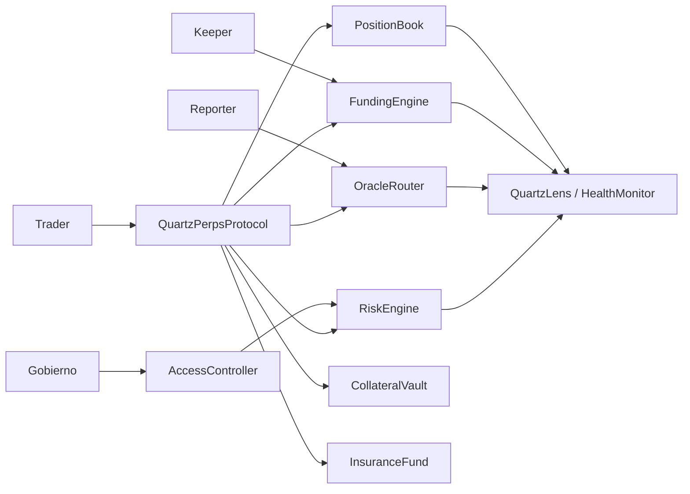
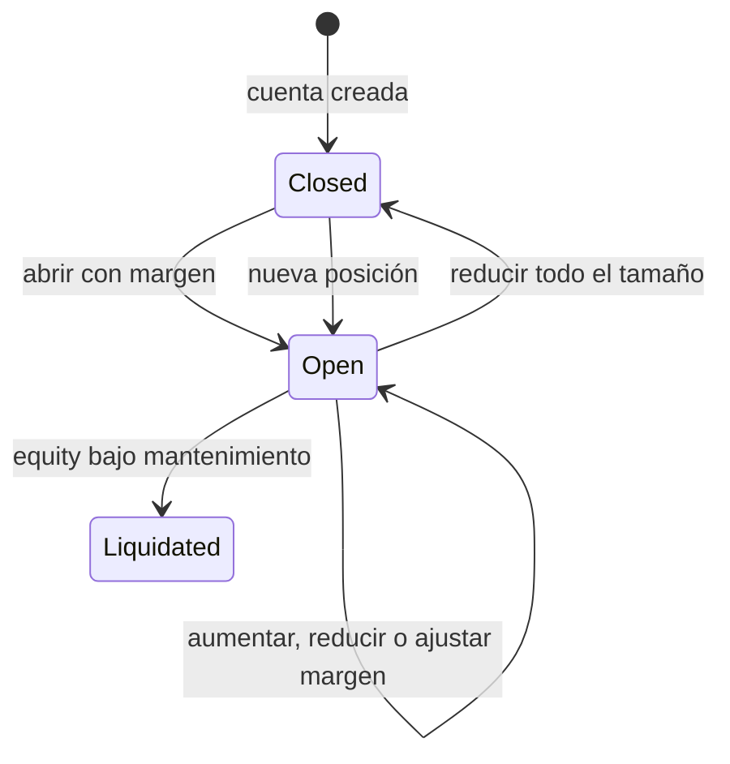

# Arquitectura de Quartz Perps

## Fronteras

`QuartzPerpsProtocol` coordina depósitos, posiciones, retiros y liquidaciones. `PositionBook` guarda el estado canónico de la posición y la exposición de cada mercado. `CollateralVault` recibe y libera qUSD; `InsuranceFund` registra ingresos y déficits. `OracleRouter` valida precio y vigencia. `FundingEngine` conserva el índice acumulado. `RiskEngine` aplica los parámetros de margen, interés abierto y skew.

Los roles separan gobierno, keeper, reporter y gestor interno. La pausa afecta al punto de entrada de operaciones. Los contratos de consulta no mutan estado; sus resultados son snapshots del bloque y no reservan liquidez ni precio para una transacción posterior.

## Ciclo de vida

Cada posición usa margen aislado por mercado, tamaño firmado (long positivo, short negativo), precio de entrada y checkpoint de funding. La exposición del mercado suma interés abierto long y short y mantiene skew firmado. Las rutas de liquidación registran recompensa y crédito de seguro; el ledger auxiliar de settlement indexa recibos por trader y mercado.

## Consideraciones de integración

El script `script/DeployQuartz.s.sol` muestra la construcción de componentes. La configuración de roles, oráculos y parámetros debe revisarse por entorno. No hay una red, token ni dirección de despliegue oficial definidos por este repositorio.
