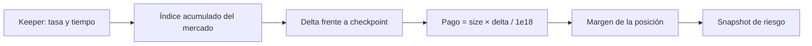

# Modelo económico

Las cantidades monetarias de la configuración y los cálculos se expresan con precisión `1e18` salvo donde una API indique otra unidad. El tamaño de posición es firmado; el nocional es positivo.

```text
notional = abs(sizeX18) × priceX18 / 1e18
unrealizedPnL(long) = size × (markPrice − entryPrice) / 1e18
unrealizedPnL(short) = abs(size) × (entryPrice − markPrice) / 1e18
equity = margin + unrealizedPnL
initial = ceil(notional × 1e18 / maxLeverageX18)
maintenance = ceil(notional × maintenanceRatioX18 / 1e18)
healthFactorX18 = equity × 1e18 / maintenance
```

`MarginMath` redondea al alza los requisitos de margen inicial y mantenimiento. Una posición es liquidable cuando `equity < maintenance`; una validación de margen inicial exige `equity ≥ initial`. Con 2 ETH a 2.000 qUSD/ETH, 10× de apalancamiento y 6,25 % de mantenimiento: nocional 4.000, inicial 400 y mantenimiento 250 qUSD antes de PnL.

## Índice de funding



`FundingMath.pendingPayment` calcula el pago firmado desde el índice actual y el último índice de la posición. Para long, un delta positivo implica débito; para short, crédito. `accrueFunding` acota la tasa solicitada y acumula `rate × elapsed / 1 day`; `pushFundingDelta` aplica un delta dentro del máximo configurado. Los consumidores deben distinguir el estado almacenado de una proyección del bloque actual.

## Cierre y seguro

Al cerrar una posición, el PnL realizado modifica el margen. Una pérdida superior al margen se registra como bad debt. En liquidación, la recompensa del liquidador se limita por la comisión calculada y el margen remanente; el resto se acredita al fondo de seguros. `reportedBadDebt − coveredBadDebt` es el déficit pendiente de cobertura. Este registro no equivale a efectivo disponible: el balance ERC-20 del fondo se consulta por separado.

El precio de referencia procede del oráculo configurado, no de una operación de mercado real. La calidad económica de una configuración depende también de la actualización de precio, parámetros y actuación de keepers y liquidadores.
