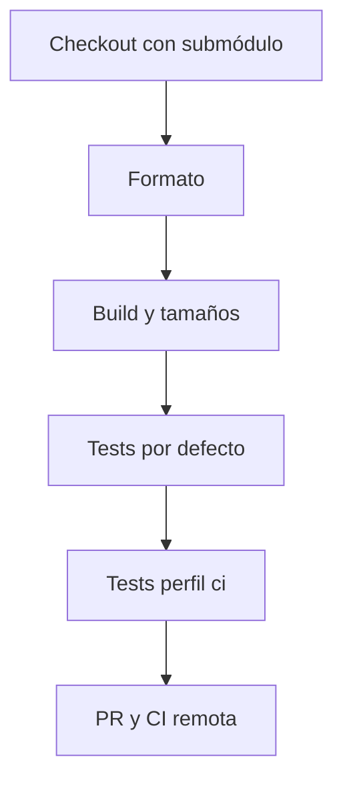

# Operación y validación

## Preparación

```bash
git clone --recurse-submodules https://github.com/SolguardLabs/QuartzPerpsProtocol.git
cd QuartzPerpsProtocol
forge fmt --check
forge build --sizes
forge test
bash scripts/ci.sh
```

Si el repositorio ya está clonado, ejecute `git submodule update --init --recursive`. `forge-std` está fijado en `.gitmodules` y en el objeto submódulo del commit; no es necesario instalar dependencias en tiempo de CI fuera del checkout. El perfil `ci` eleva las iteraciones de fuzzing e invariantes de Foundry.



## Lecturas operativas

1. Compruebe que el mercado está habilitado y que `OracleRouter` devuelve un precio dentro de la ventana de frescura.
2. Consulte `QuartzLens.market` para exposición, skew, precio e índice de funding.
3. Consulte `QuartzLens.account` y `HealthMonitor.report` para comparar posición almacenada y proyección de riesgo.
4. Reconcile `PositionBook`, `CollateralVault` e `InsuranceFund` tras operaciones de liquidación.

Las vistas de riesgo no garantizan que una transacción posterior conserve el mismo precio o índice. Automatizaciones deben tratar reverts y reintentos como parte de su operación normal. `SettlementLedger` indexa recibos por trader y mercado, pero no sustituye eventos ni un indexador persistente.

## Release

El proceso de versión exige PR, CI en `main`, rama `production` en el mismo commit, tag anotado `v1.0.0`, CI del tag y release publicado. El workflow de integridad compara las tres referencias. Un resultado CI verde verifica el código y tests configurados, no constituye una auditoría externa.
