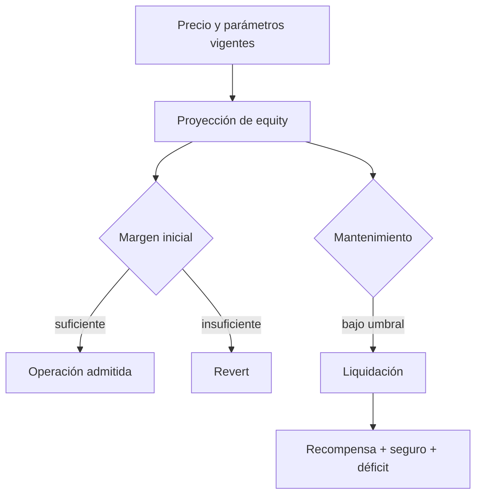

# Seguridad operativa

## Controles por dominio

| Dominio | Control | Evidencia |
| --- | --- | --- |
| Acceso | Roles de gobierno, reporter, keeper y gestor | `QuartzAccessController` |
| Precio | Bounds y heartbeat por feed | `OracleRouter` |
| Riesgo | Inicial, mantenimiento, OI y skew | `RiskEngine` |
| Estado | Posición aislada y exposición persistida | `PositionBook` |
| Fondos | Entrada/salida de colateral | `CollateralVault` |
| Déficit | Registro y cobertura contable | `InsuranceFund` |
| Observabilidad | Snapshots y clasificación de salud | `QuartzLens`, `HealthMonitor` |

Los cálculos usan enteros y reglas de redondeo específicas; los límites de mercado se configuran por gobierno. La proyección de `HealthMonitor` incorpora el índice de funding actual al clasificar lotes y al evaluar una cuenta para intervención de keeper. El reporte individual conserva además la vista del estado almacenado para observabilidad.

## Supuestos y límites

El token de colateral debe comportarse como ERC-20 estándar. El oráculo y los keepers son dependencias operativas: una configuración errónea, datos caducados o retrasos en la ejecución pueden cambiar el riesgo observable. Los contratos no incorporan gobernanza temporalizada, mensajería cross-chain ni protección frente a un token no estándar. Ningún resultado de tests demuestra solvencia frente a todas las combinaciones de precio, tasa y exposición.

La política de divulgación responsable se encuentra en [SECURITY.md](../SECURITY.md).
